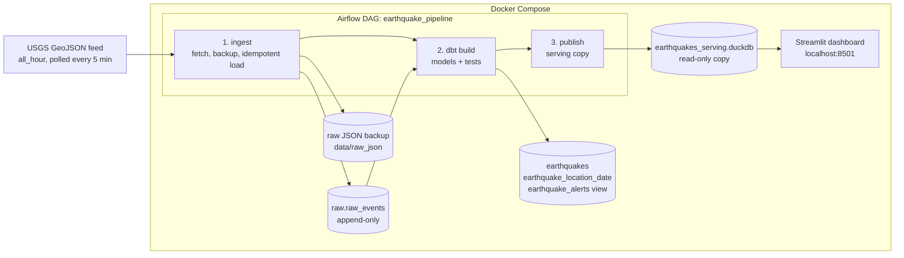
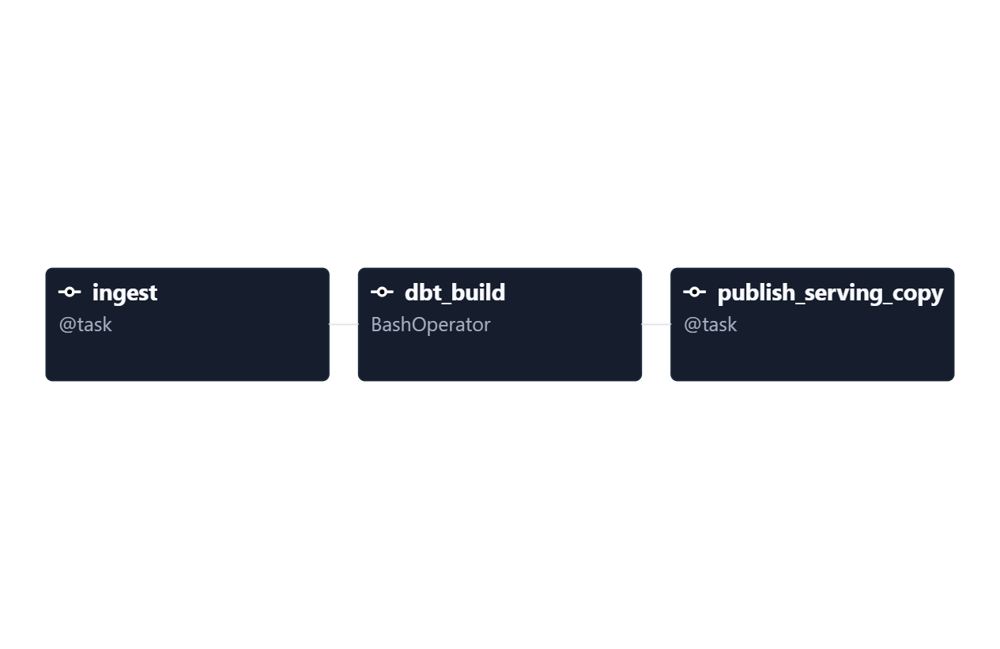
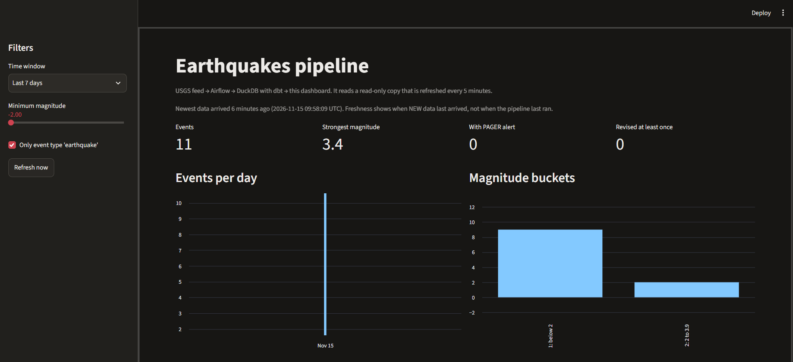
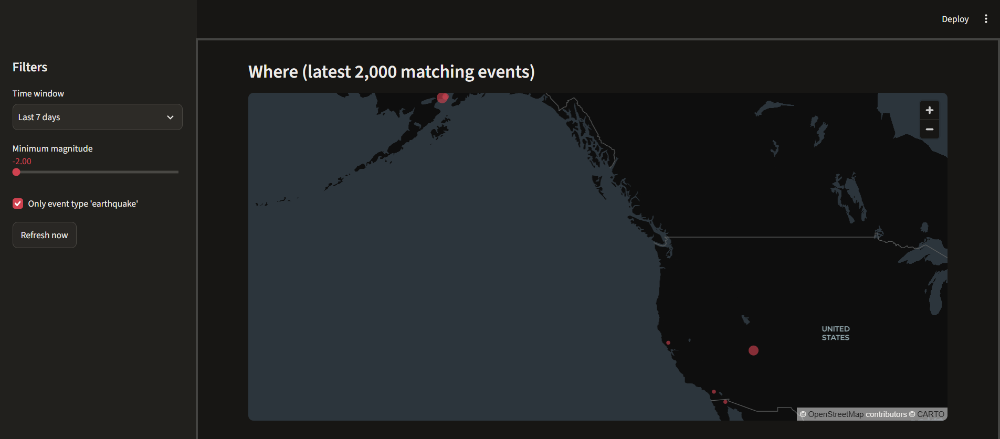
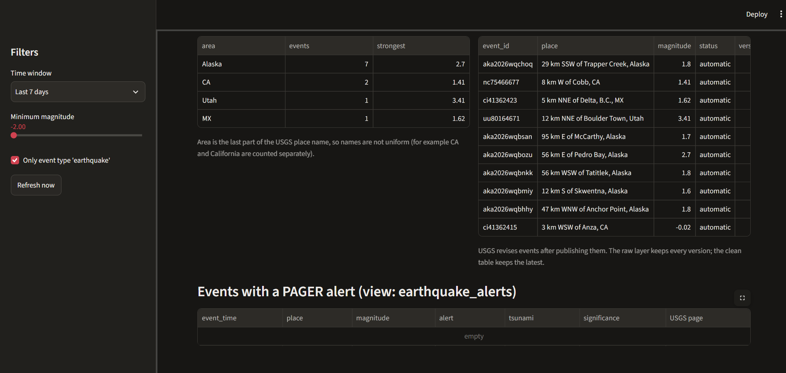

# Earthquakes pipeline

An end-to-end data pipeline that ingests the public [USGS earthquake feed](https://earthquake.usgs.gov/earthquakes/feed/v1.0/geojson.php) every 5 minutes, stores every revision of every event, builds tested analytics tables, and serves them in a dashboard. Everything runs locally with one `docker compose up`.

**Stack:** Airflow 3 (orchestration) · DuckDB (columnar warehouse) · dbt (transformations and data-quality tests) · pytest · Streamlit (dashboard) · Docker Compose

## Architecture



### Airflow graph view

### Dashboard view



## What the pipeline does

Every 5 minutes the `earthquake_pipeline` DAG runs three tasks in order:

1. **ingest** downloads the "past hour" GeoJSON feed, saves the exact file to `data/raw_json/`, and inserts every event *version* into `raw.raw_events`.
2. **dbt_build** runs the dbt models and all data-quality tests. A failing test fails the task.
3. **publish_serving_copy** copies the finished database to `earthquakes_serving.duckdb` for the dashboard. It only runs if the previous step succeeded, so the dashboard never shows data that failed its tests.

### Data model

| Object | Type | What it holds |
|---|---|---|
| `raw.raw_events` | table | Every version of every event as received (JSON), keyed by `(event_id, updated_ms)` |
| `main.earthquakes` | table | One row per event: the latest version, typed columns, times in UTC, `versions_seen` |
| `main.earthquake_location_date` | table | Where and when: date, hour, place, area, coordinates, magnitude bucket |
| `main.earthquake_alerts` | view | Events that have a PAGER alert level (rare, so a view and not a stored copy) |

## Design decisions

- **Idempotent loads.** The primary key of `raw.raw_events` is `(event_id, updated_ms)`, and inserts use `ON CONFLICT DO NOTHING`. Each hourly download overlaps the previous ones, so the same event arrives many times; re-running any task or replaying any file never creates duplicates.
- **Revisions are kept.** USGS revises events after publishing them (magnitude, number of stations, review status). Because `updated_ms` is part of the key, each revision is stored as a new raw row, and the clean `earthquakes` table keeps only the latest. One real event in my data (a magnitude 3.4 near Conconully, Washington) was stored in 10 versions within about 45 minutes (by their `updated` timestamps), with the magnitude and the number of stations changing along the way.
- **Raw backup and replay.** Every downloaded file is also saved to `data/raw_json/` (written to a temp file and renamed, so it is never half-written). `include/replay_backups.py` rebuilds `raw.raw_events` from those files, which I used after recreating the warehouse volume.
- **One writer.** DuckDB allows a single writing process per file, and readers cannot open a file while it is being written. The DAG tasks run strictly in sequence (`max_active_runs=1`), and the dashboard reads a separate copy that is swapped in atomically after each successful run.
- **Outage tolerance.** Each download covers the past hour, so a failed or skipped run loses nothing as long as the next successful run happens within about an hour. The retry settings are 2 retries, 1 minute apart. A longer outage can be repaired with the backfill below.

## Data quality

- **21 dbt tests**: `unique` and `not_null` on `event_id`, accepted values for `status`, `alert` and `tsunami`, coordinate and magnitude/depth ranges, a check that the latest version of each event is the one kept, a check that no raw event is missing from the clean table, plus tests on the mart models.
- **14 pytest tests** for the Python code: idempotent loading, revisions, overlapping feeds, malformed features, empty feeds, fetch retries, the backup file logic, the serving copy, and a real revision captured from the live feed (`tests/fixtures/`).
- **Source freshness** is defined on `raw.raw_events` (`dbt source freshness`). It measures when *new* data last arrived, not when the pipeline last ran, so a quiet hour can warn even when everything is healthy.

## Run it

Requirements: Docker Desktop (Compose v2).

```bash
docker compose up -d --build
```

| Service | URL | Notes |
|---|---|---|
| Airflow | http://localhost:8080 | Local use only: the login screen is disabled and the port is bound to 127.0.0.1 |
| Dashboard | http://localhost:8501 | Shows a message until the first DAG run has published the serving copy |

The DAG is active from the start. To see data sooner, trigger `earthquake_pipeline` once in the Airflow UI.

### Useful commands

```bash
# Run the Python tests
docker compose exec airflow python -m pytest /opt/airflow/tests -v

# Run dbt by hand (pause the DAG first, to avoid two writers)
docker compose exec airflow bash -c 'cd /opt/airflow/dbt && $DBT_BIN build'

# One-time backfill with the last 30 days (about 10,000 events)
docker compose exec airflow python /opt/airflow/include/ingest.py --feed-url https://earthquake.usgs.gov/earthquakes/feed/v1.0/summary/all_month.geojson

# Rebuild raw.raw_events from the saved JSON files
docker compose exec airflow python /opt/airflow/include/replay_backups.py

# Show every stored version of the most-revised event (or pass an event id)
docker compose exec airflow python /opt/airflow/include/event_history.py
```

If the dashboard reports a DuckDB version error, set `DUCKDB_VERSION` in a `.env` file to the version used by the pipeline (`docker compose exec airflow python -c "import duckdb; print(duckdb.__version__)"`) and rebuild the dashboard.

## Repository layout

```
dags/            Airflow DAG (ingest -> dbt build -> publish)
include/         ingest, publish, replay and inspection scripts
dbt/             dbt project: staging model, marts, tests
dashboard/       Streamlit app
tests/           pytest tests and real sample files (fixtures/)
data/raw_json/   raw JSON backups (created by the pipeline, gitignored)
```

## Observed in operation


- Over the first evening and night, about 70 scheduled runs succeeded and 2 failed. The failures coincided with a local network interruption; the next successful run picked up the missed events.

## Limitations

- **Polling, not streaming.** Data is at most about 5 minutes old, and USGS offers no push feed in this form.
- **DuckDB is a single-writer database.** The serving-copy pattern works around that for one dashboard; it is not a multi-user design.
- **Airflow runs in `standalone` mode with SQLite metadata and no login.** That is fine for a local proof of concept, not for a shared deployment.
- **Place names are not uniform.** The `area` column is the last part of the USGS place text, so names like `CA` and `California` are counted separately.
- **The `earthquakes` model is rebuilt on every run.** That is simple and correct at this size, and would need to become incremental with much more data.
- **Raw backups grow without limit** (roughly 10 to 20 MB per day) and have no retention policy.

## What I would improve with more time

- Incremental dbt models and a retention policy for raw backups.
- Alerting when a run fails or data goes stale (email or chat message), plus dbt docs and a lineage graph.
- CI (for example GitHub Actions) running pytest and `dbt parse` on every push.
- A high-impact events view based on alert level, tsunami flag and significance, once the thresholds are validated.
- Proper region names through reverse geocoding instead of parsing the place text.
- A message queue for true streaming, a server-based columnar store such as ClickHouse for concurrent readers, and a cloud deployment if the data volume grew.

## License

MIT, see [LICENSE](LICENSE).

Earthquake data comes from the U.S. Geological Survey (USGS).